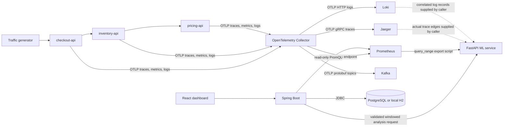

# Telemetry and AI analysis data-flow (Phase 3)

Phase 2 moves explicitly synthetic demo telemetry through a real local telemetry stack. It is not production workload data.

## Implemented flow



Kafka receives `otel-traces`, `otel-metrics`, and `otel-logs`. There is no Kafka consumer. Spring proxies caller-provided, validated metric windows to the ML service. `ml-service/scripts/extract_prometheus_history.py` can export historical Prometheus metric series; trace edges and correlated log evidence are currently queried/provided by the caller rather than automatically fetched by Spring. Analysis results are not persisted.

## Signals

| Signal | Origin | Transport | Store | Current use |
| --- | --- | --- | --- | --- |
| Metrics | Custom OTel request counter and duration histogram | OTLP to Collector; Collector Prometheus exporter is scraped every 10 seconds | Prometheus | Dashboard rates, 5xx ratio, p95 latency |
| Logs | Python logging with OTel log handler | OTLP to Collector | Loki | Evidence accepted by the caller-supplied RCA request |
| Traces | FastAPI and HTTPX instrumentation | OTLP to Collector | Jaeger | Actual dependency edges accepted by the caller-supplied RCA request |
| Stream | Collector signal exporters | Kafka OTLP protobuf | Kafka topics | Buffer for future consumers; not a durable production guarantee |

The Spring API queries these PromQL expressions over a five-minute range:

```promql
sum by (service_name) (rate(aexa_service_requests_total[5m]))
sum by (service_name) (rate(aexa_service_requests_total{status_code=~"5.."}[5m]))
histogram_quantile(0.95, sum by (service_name, le) (rate(aexa_request_duration_seconds_bucket[5m])))
```

The API returns `hasData: false` and null KPI values when the query succeeds but has no request samples. If Prometheus is unreachable or returns invalid data, the API returns a problem response with HTTP 503; it never substitutes sample values.

## Shared identity and time

Each demo service sets OpenTelemetry resource attributes:

| Attribute | Example | Purpose |
| --- | --- | --- |
| `service.name` | `checkout-api` | Stable service identifier |
| `service.namespace` | `demo` | Workload grouping |
| `service.version` | `0.2.0` | Deployed code version |
| `deployment.environment` | `demo` | Demo data is distinguished from production |
| `service.instance.id` | `hostname-pid` | Instance identity |
| `trace_id` | 32 lowercase hexadecimal characters | Request correlation |
| `span_id` | 16 lowercase hexadecimal characters | Span correlation |
| `timestamp` | UTC instant | Metrics, log records, spans |

The OTel SDK provides trace/span identifiers and timestamps; the Collector inserts `service.namespace=demo` and `deployment.environment=demo` only if absent. The Collector's Prometheus exporter converts resource attributes to metric labels (for example, `service.name` to `service_name`). Downstream HTTP calls propagate W3C trace context.

Catalog joins use `(service.name, deployment.environment)`. The telemetry overview remains read-only. Phase 3 RCA uses actual supplied trace-edge and service metadata, but its ranking is observational and does not prove causality. All analysis timestamps are timezone-aware UTC-normalized instants.

## Failure and safety behavior

- The service fault endpoint supports only `none`, `latency`, and `error`; it is local-demo-only and unauthenticated.
- Fault state is in-memory, resets on restart, and must not be exposed outside localhost.
- Collector exporter failures are not converted into successful telemetry responses.
- A missing Prometheus or empty query result is represented separately from an observed zero error rate.
- The traffic-generator is clearly labelled synthetic; no accuracy or operational-impact figures are inferred.
- The ML process has no Collector control or infrastructure actuation permissions.
- Evaluated training data is deterministic synthetic data; Prometheus exports are not treated as labeled ground truth.
